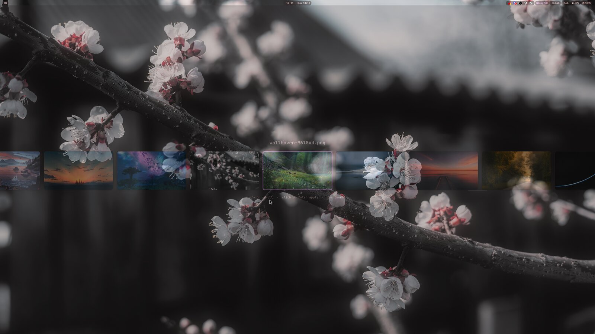
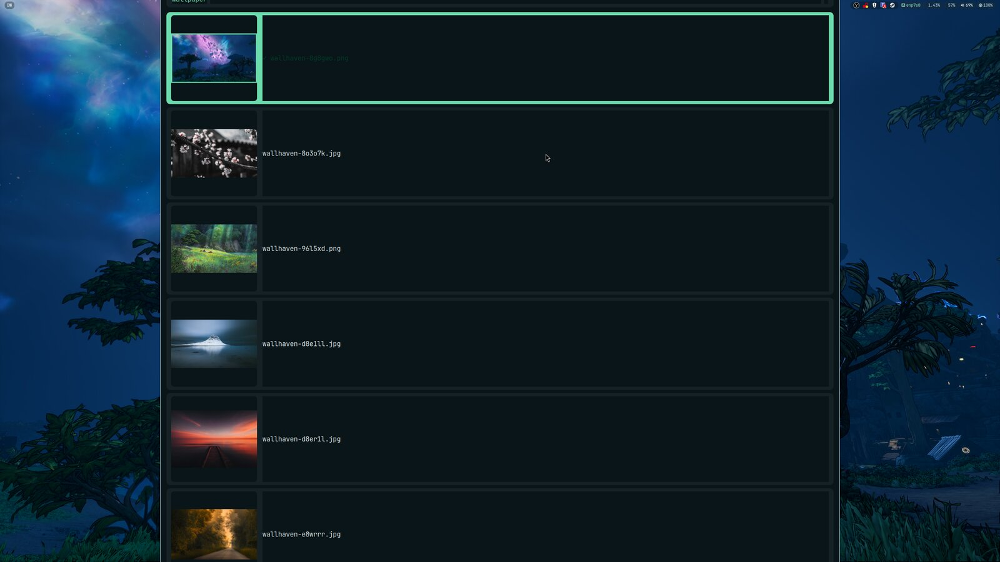

# wallswitch

A wallpaper switcher for Wayland with two pickers: a **GTK4 layer-shell carousel**
and a **rofi list with image previews**. It caches thumbnails, remembers the active
wallpaper, and runs a configurable apply hook so it fits into any theme pipeline
(matugen, pywal, plain `awww`/`swww`, …).





## Features

- **Carousel picker** — fullscreen overlay with a blurred backdrop and a horizontal
  row of thumbnails. `←`/`→` or scroll to browse, `Enter`/click applies, `Esc`
  cancels. Selection gets a theme-accent border; the current wallpaper is
  pre-selected.
- **rofi picker** — dmenu-style list with large previews. The active wallpaper is
  marked with `✓` and an accent border around its preview, and the list opens on
  it (`-selected-row`), so `Enter` re-applies the current one.
- **Instant after the first run** — thumbnails are cached (parallel decode,
  mtime-checked) and preloaded ±10 cards around the selection.
- **Any compositor** — works on mangowm, Hyprland, Sway, river, … (anything with
  wlr-layer-shell). Falls back to a fullscreen window without it.
- **Any theme pipeline** — `apply_command` is a shell hook; the bundled palette
  can be replaced by a matugen/pywal `colors.json`.
- **Stateful** — the last applied wallpaper is recorded, reused for pre-selection
  and marking.
- **No Python dependencies** — standard library only. GTK/rofi/ImageMagick are
  optional and detected at runtime.

## Requirements

| Dependency | Arch | Debian/Ubuntu | Needed for |
|---|---|---|---|
| Python ≥ 3.9 | `python` | `python3` | everything |
| PyGObject | `python-gobject` | `python3-gi` | carousel, thumbnails (GdkPixbuf) |
| GTK4 | `gtk4` | `gir1.2-gtk-4.0` | carousel |
| gtk4-layer-shell | `gtk4-layer-shell` | `libgtk4-layer-shell0` | carousel overlay (optional) |
| rofi | `rofi` | `rofi` | the list picker (`rofi-wayland` on Wayland) |
| ImageMagick | `imagemagick` | `imagemagick` | webp thumbnails, blur backdrop, accent border (optional) |
| Wallpaper setter | `awww` / `swww` / `swaybg` / `feh` | same | applying the image — **or** set `apply_command` |
| matugen | `matugen` | — | only if you generate the palette (optional) |

```bash
# Arch
sudo pacman -S python python-gobject gtk4 gtk4-layer-shell rofi imagemagick
# plus a setter, e.g.:
paru -S awww        # or: sudo pacman -S swww swaybg
```

Tested on Arch/CachyOS with mangowm (wlroots 0.20) and Hyprland.

## Install

```bash
git clone https://github.com/mikul-/wallswitch.git
cd wallswitch
./install.sh                     # ~/.local/bin, ~/.local/lib/wallswitch, ~/.local/share/wallswitch
```

System-wide:

```bash
PREFIX=/usr/local sudo ./install.sh
```

The installer checks the optional dependencies, installs the three commands and a
default config (`~/.config/wallswitch/config.json`), and prints bind examples.
It will not overwrite an existing config.

Manual install: copy `bin/wallswitch*` to a directory in `$PATH`, `lib/wallswitch/`
to `<prefix>/lib/wallswitch/`, and `share/wallswitch/` to `<prefix>/share/wallswitch/`.

## Configure

`~/.config/wallswitch/config.json` (created by the installer; every key is
optional):

| Key | Default | Meaning |
|---|---|---|
| `wallpaper_dir` | `~/Pictures/Wallpapers` | scanned for `jpg/jpeg/png/webp/bmp` |
| `state_file` | `~/.local/state/wallswitch/wallpaper` | last applied wallpaper |
| `cache_dir` | `~/.cache/wallswitch` | thumbnails, blur backdrop, carousel FIFO |
| `apply_command` | `""` | shell hook run on apply; `{wallpaper}` → quoted path |
| `rofi_theme` | `""` | extra rofi theme; empty = bundled `share/wallswitch/rofi.rasi` |
| `palette_file` | `""` | matugen-style `colors.json` (`surface`, `primary`, …) |
| `accent` | `""` | override the accent colour, e.g. `#7aa2f7` |
| `thumb_size` | `440` | longest edge of cached thumbnails |

Without `apply_command`, wallswitch applies the image with the first available of
`awww`, `swww`, `swaybg`, `feh` and writes the state file itself.

Example — plain compositor, default everything:

```json
{
  "wallpaper_dir": "~/Pictures/Wallpapers"
}
```

Example — theme pipeline hook (matugen via a `theme-apply` script):

```json
{
  "wallpaper_dir": "~/Pictures/Wallpapers",
  "apply_command": "theme-apply {wallpaper}",
  "state_file": "~/.local/state/wallpaper",
  "palette_file": "~/.config/matugen/colors.json",
  "rofi_theme": "~/.config/rofi/wallpaper.rasi"
}
```

`apply_command` runs through `sh -c` with `{wallpaper}` replaced by the
shell-quoted path, so anything works:

```json
{ "apply_command": "awww img {wallpaper} --transition-type any" }
{ "apply_command": "swww img {wallpaper} && wal -i {wallpaper} && kill -USR1 $(pidof kitty)" }
```

## Usage

```text
wallswitch pick | rofi     rofi list picker with image previews
wallswitch carousel        GTK4 layer-shell carousel picker
wallswitch next | prev     carousel next/prev (opens it when closed)
wallswitch apply <path>    apply a specific wallpaper
wallswitch list            print the wallpaper list
wallswitch thumbs          build/refresh the thumbnail cache (--force, --prune)
wallswitch config          show the effective configuration
wallswitch version         show the version
```

`next`/`prev` open the carousel pre-selected at the neighbouring wallpaper if no
picker is running; if the carousel is already open they just move the selection.

## Keybinds

mangowm (`~/.config/mango/config.conf`):

```ini
bind=SUPER+SHIFT,W,spawn,wallswitch pick
bind=SUPER+SHIFT,Right,spawn,wallswitch next
bind=SUPER+SHIFT,Left,spawn,wallswitch prev
```

Hyprland (`~/.config/hypr/hyprland.conf`):

```ini
bind = SUPER SHIFT, W, exec, wallswitch pick
bind = SUPER SHIFT, right, exec, wallswitch next
bind = SUPER SHIFT, left, exec, wallswitch prev
```

Sway (`~/.config/sway/config`):

```ini
bindsym $mod+Shift+w exec wallswitch pick
bindsym $mod+Shift+Right exec wallswitch next
bindsym $mod+Shift+Left exec wallswitch prev
```

## Theming

- **Carousel**: colours come from `palette_file` (matugen `colors.json` keys:
  `surface`, `surface_container`, `on_surface`, `primary`, …) with a sane dark
  fallback. `accent` overrides `primary`.
- **rofi**: `share/wallswitch/rofi.rasi` is a clean starting point — copy it to
  `~/.config/wallswitch/rofi.rasi` and edit the variables at the top, or point
  `rofi_theme` at a theme generated by matugen/pywal.
- The active wallpaper's preview in the rofi list gets a 6 px border in the
  accent colour (`accent`/`primary`), and the carousel selection gets a 3 px one.

With matugen/pywal, generate the theme from `share/wallswitch/rofi.rasi`: copy that file as
your template and replace the hex values with template variables, e.g.

```css
/* ~/.config/matugen/templates/wallswitch.rasi */
* {
    bg:        {{colors.surface.default.hex}};
    bg-alt:    {{colors.surface_container.default.hex}};
    fg:        {{colors.on_surface.default.hex}};
    fg-dim:    {{colors.on_surface_variant.default.hex}};
    accent:    {{colors.primary.default.hex}};
    accent-fg: {{colors.on_primary.default.hex}};
    outline:   {{colors.outline.default.hex}};
}
/* ...the rest of share/wallswitch/rofi.rasi unchanged... */
```

…then point `rofi_theme` at the generated file.

## How it works

- **Scanning** — `wallpaper_dir` is globbed for `jpg/jpeg/png/webp/bmp`
  (case-insensitive) and sorted by name.
- **Thumbnails** — `cache_dir/thumbs/<name>.jpg`, regenerated when the source is
  newer. Decoded with GdkPixbuf in a small process pool, with an ImageMagick
  fallback for webp/16-bit/odd files.
- **State** — the applied path is written to `state_file`; both pickers read it to
  pre-select and mark the active wallpaper.
- **Apply** — `apply_command` (if set) or the first available built-in setter.
  Hook output goes to the terminal, so theme scripts can log.
- **Singleton carousel** — a per-user FIFO (`cache_dir/ctl`) carries
  `next`/`prev`/`apply`/`toggle` to a running instance; if the FIFO is missing or
  stale the command launches a new instance instead.

## Troubleshooting

- **`wallswitch next` does nothing / the carousel never appears.** Check
  `~/.cache/wallswitch/ctl`: it must be a FIFO (`ls -l` shows `prw-`). A stale
  regular file (e.g. from `echo next > ctl`) is detected and removed
  automatically, but you can delete it manually: `rm -f ~/.cache/wallswitch/ctl`.
- **The carousel is a normal fullscreen window, not an overlay.** Install
  `gtk4-layer-shell` and make sure your compositor supports wlr-layer-shell.
- **No previews in rofi.** Run `wallswitch thumbs`. For webp, install
  ImageMagick. Rofi needs `-show-icons` support (all current versions do).
- **Wallpaper applied but colours/fonts didn't change.** wallswitch only sets the
  image; use `apply_command` to run your theme generator.
- **Keys are swallowed while a picker is open.** Both pickers grab the keyboard:
  `←`/`→` move in the carousel, `Esc` closes it; rofi behaves like rofi.
- **Wrong directory / config ignored.** `wallswitch config` prints the config
  file actually in use (override it with `$WALLSWITCH_CONFIG`).

## Uninstall

```bash
./install.sh --uninstall                 # or: PREFIX=/usr/local sudo ./install.sh --uninstall
rm -rf ~/.config/wallswitch ~/.cache/wallswitch ~/.local/state/wallswitch
```

## License

MIT — see [LICENSE](LICENSE).
